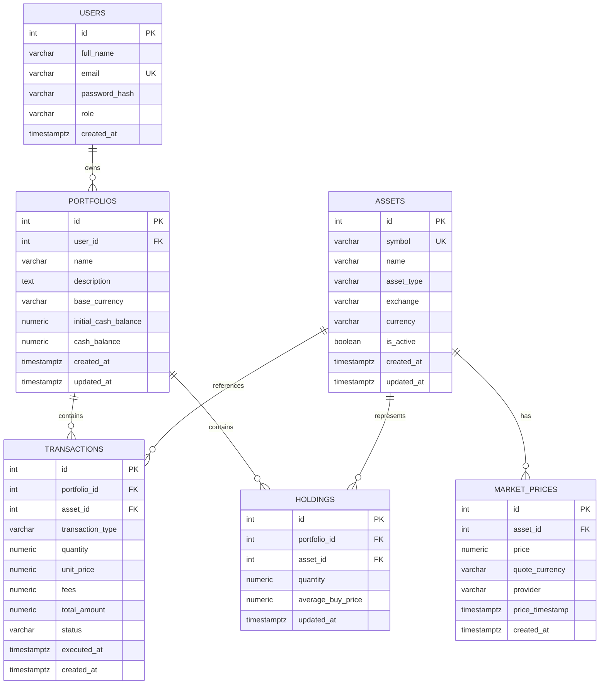

# TradePulse – Database Design

**Version:** 1.1  
**Status:** Updated Design  
**Database:** PostgreSQL 17  
**ORM:** SQLAlchemy 2.x  
**Migration Tool:** Alembic

---

## 1. Database Overview

PostgreSQL is the primary relational database for TradePulse.

SQLAlchemy ORM 2.x will be used to define entities, relationships, and database operations. Alembic will manage schema migrations.

The database must support:

- User accounts and authentication.
- Role-based access control.
- Multiple portfolios per user.
- Supported investment assets.
- Simulated buy and sell transactions.
- Portfolio holdings and cash balances.
- Historical market prices.
- Portfolio analytics.
- Future AI research and assistant functionality.

## 2. Database Design Principles

1. Use normalized relational structures where appropriate.
2. Use primary keys for entity identification.
3. Use foreign keys to maintain referential integrity.
4. Enforce unique constraints for business-critical fields.
5. Use `NUMERIC` for monetary values and quantities.
6. Use timezone-aware timestamps.
7. Maintain an auditable transaction history.
8. Associate private financial records with their owners.
9. Use database migrations for schema changes.
10. Avoid storing redundant calculated values unless there is a clear performance requirement.
11. Enforce valid user roles through database constraints.
12. Preserve asset records referenced by historical transactions.

## 3. Entity Relationship Overview

The database will contain the following core entities:

- users
- portfolios
- assets
- transactions
- holdings
- market_prices

### 3.1 Entity Relationships



## 4. Table Definitions

### 4.1 users

Stores user account information and authorization roles.

| Column | PostgreSQL Type | Constraints |
|---|---|---|
| id | INTEGER | Primary key |
| full_name | VARCHAR(100) | NOT NULL |
| email | VARCHAR(255) | NOT NULL, UNIQUE |
| password_hash | VARCHAR(255) | NOT NULL |
| role | VARCHAR(20) | NOT NULL, DEFAULT 'USER' |
| created_at | TIMESTAMPTZ | NOT NULL, DEFAULT NOW() |

**Role constraint:**

```sql
CHECK (role IN ('ADMIN', 'USER'))
```

**Role definitions:**

| Role | Responsibility |
|---|---|
| ADMIN | Platform administration and asset catalog management |
| USER | Portfolio management and investment activities |

**Business rules:**

- Every user must have a valid role.
- New registrations receive the `USER` role by default.
- Public registration must not allow users to select their role.
- Initial ADMIN accounts are provisioned through a controlled manual database operation.
- Role values must be restricted to `ADMIN` and `USER`.
- ADMIN and USER responsibilities are strictly separated.
- ADMIN accounts cannot access portfolio management or paper-trading operations under the initial authorization model.

**Current implementation status:** Implemented.

### 4.2 portfolios

Stores portfolios created by USER accounts.

| Column | PostgreSQL Type | Constraints |
|---|---|---|
| id | INTEGER | Primary key |
| user_id | INTEGER | Foreign key to users.id, NOT NULL |
| name | VARCHAR(100) | NOT NULL |
| description | TEXT | Nullable |
| base_currency | VARCHAR(3) | NOT NULL, DEFAULT 'USD' |
| initial_cash_balance | NUMERIC(20,2) | NOT NULL, DEFAULT 100000.00 |
| cash_balance | NUMERIC(20,2) | NOT NULL, DEFAULT 100000.00 |
| created_at | TIMESTAMPTZ | NOT NULL |
| updated_at | TIMESTAMPTZ | NOT NULL |

**Business rules:**

- A USER can create multiple portfolios.
- Every portfolio belongs to exactly one user.
- A user cannot access another user's portfolio.
- ADMIN accounts cannot manage portfolios.
- Portfolio names must be validated.
- Base currency determines the currency used for portfolio-level reporting.
- Initial cash balance represents the portfolio's starting virtual cash.
- Cash balance represents the current available virtual cash.
- Portfolio deletion must follow a defined policy for associated transactions and holdings.

**Current implementation status:** Implemented. CRUD APIs and ownership validation have been tested. USER-only role authorization requires final verification.

### 4.3 assets

Stores the platform's supported investment assets.

Asset records are shared platform resources and are not owned by individual users.

| Column | PostgreSQL Type | Constraints |
|---|---|---|
| id | INTEGER | Primary key |
| symbol | VARCHAR(20) | NOT NULL, UNIQUE |
| name | VARCHAR(150) | NOT NULL |
| asset_type | VARCHAR(20) | NOT NULL |
| exchange | VARCHAR(50) | Nullable |
| currency | VARCHAR(3) | NOT NULL, DEFAULT 'USD' |
| is_active | BOOLEAN | NOT NULL, DEFAULT TRUE |
| created_at | TIMESTAMPTZ | NOT NULL |
| updated_at | TIMESTAMPTZ | NOT NULL |

**Asset type constraint:**

```sql
CHECK (asset_type IN ('STOCK', 'CRYPTO'))
```

**Initial asset categories:**

- STOCK
- CRYPTO

Additional asset categories, such as ETF, may be introduced when supported by the application and market-data provider.

**Business rules:**

- Asset symbols must be unique in the initial implementation.
- Asset symbols should be normalized to uppercase.
- ADMIN accounts can create and update assets.
- ADMIN accounts can activate or deactivate assets.
- USER accounts can view the asset catalog.
- USER accounts cannot create, update, or deactivate assets.
- Inactive assets must not be available for new transactions.
- Asset records should not be physically deleted if referenced by historical transactions.
- Asset deactivation should use the `is_active` flag.

**Current implementation status:** Database model, migration, schemas, and service layer implemented. API authorization and endpoint testing are pending final verification.

### 4.4 transactions

Stores simulated trading activity.

| Column | PostgreSQL Type | Constraints |
|---|---|---|
| id | BIGINT | Primary key |
| portfolio_id | BIGINT | Foreign key |
| asset_id | BIGINT | Foreign key |
| transaction_type | VARCHAR(10) | NOT NULL |
| quantity | NUMERIC(28,10) | NOT NULL |
| unit_price | NUMERIC(28,10) | NOT NULL |
| fees | NUMERIC(28,10) | NOT NULL |
| total_amount | NUMERIC(28,10) | NOT NULL |
| status | VARCHAR(20) | NOT NULL |
| executed_at | TIMESTAMPTZ | NOT NULL |
| created_at | TIMESTAMPTZ | NOT NULL |

**Transaction types:**

- BUY
- SELL

**Initial status:**

- EXECUTED

Additional statuses may be introduced if order simulation requires pending, rejected, or cancelled states.

**Business rules:**

- Quantity must be greater than zero.
- Unit price must be greater than zero.
- Fees must be non-negative.
- SELL quantity cannot exceed available holdings.
- BUY transactions must respect the available simulated cash balance.
- Every executed transaction must be recorded.
- Transaction records should be immutable through ordinary user operations.
- Duplicate requests must not create duplicate transactions.

The `total_amount` calculation must follow a documented convention. Initially:

BUY total = quantity × unit_price + fees

SELL proceeds = quantity × unit_price − fees

The system must retain enough information to reproduce transaction calculations.

**Current implementation status:** Planned.

### 4.5 holdings

Stores the current position of an asset in a portfolio.

| Column | PostgreSQL Type | Constraints |
|---|---|---|
| id | BIGINT | Primary key |
| portfolio_id | BIGINT | Foreign key |
| asset_id | BIGINT | Foreign key |
| quantity | NUMERIC(28,10) | NOT NULL |
| average_buy_price | NUMERIC(28,10) | NOT NULL |
| updated_at | TIMESTAMPTZ | NOT NULL |

**Constraints:**

- Unique combination of portfolio_id and asset_id.
- Quantity cannot be negative.
- Zero-quantity positions should be handled consistently.

Holdings are derived from executed transactions and maintained as a transactional position projection. Transaction history remains the source of truth.

Portfolio transactions and corresponding holdings updates must occur within a database transaction.

**Current implementation status:** Planned.

### 4.6 market_prices

Stores market price observations.

| Column | PostgreSQL Type | Constraints |
|---|---|---|
| id | BIGINT | Primary key |
| asset_id | BIGINT | Foreign key |
| price | NUMERIC(28,10) | NOT NULL |
| quote_currency | VARCHAR(10) | NOT NULL |
| provider | VARCHAR(100) | NOT NULL |
| price_timestamp | TIMESTAMPTZ | NOT NULL |
| created_at | TIMESTAMPTZ | NOT NULL |

**Business rules:**

- Price must be greater than zero.
- Provider information must be preserved.
- Price timestamps must be stored in UTC.
- Historical prices should not be overwritten by new observations.
- The application must identify stale or unavailable market prices.

**Current implementation status:** Planned.

## 5. Database Relationships

### 5.1 User to Portfolio

One user can own multiple portfolios.

Relationship:

```text
users.id → portfolios.user_id
```

Ownership must be validated through the authenticated user.

### 5.2 Portfolio to Transactions

One portfolio can contain multiple transactions.

Relationship:

```text
portfolios.id → transactions.portfolio_id
```

### 5.3 Asset to Transactions

One asset can appear in multiple transactions.

Relationship:

```text
assets.id → transactions.asset_id
```

### 5.4 Portfolio to Holdings

One portfolio can contain multiple asset holdings.

Relationship:

```text
portfolios.id → holdings.portfolio_id
```

### 5.5 Asset to Market Prices

One asset can have multiple historical price records.

Relationship:

```text
assets.id → market_prices.asset_id
```

## 6. Financial Data Handling

Financial values must use Python `Decimal` and PostgreSQL `NUMERIC`.

Do not use binary floating-point values for authoritative monetary calculations.

The application must distinguish:

- Asset quantity.
- Unit price.
- Transaction fees.
- Transaction amount.
- Cash balance.
- Realized profit/loss.
- Unrealized profit/loss.
- Portfolio valuation.

Currency conversions must use explicit exchange-rate data and documented conversion timestamps.

## 7. Indexing Strategy

Initial indexes:

| Table | Index | Purpose |
|---|---|---|
| users | Unique email | User lookup |
| users | role | Optional role-based filtering |
| portfolios | user_id | Retrieve user portfolios |
| assets | id | Asset primary-key lookup |
| assets | symbol | Unique asset lookup |
| transactions | portfolio_id | Transaction history |
| transactions | asset_id | Asset transaction history |
| holdings | portfolio_id, asset_id | Unique portfolio position |
| market_prices | asset_id, price_timestamp | Historical price retrieval |

Indexes will be reviewed based on actual query patterns and performance measurements.

## 8. Data Integrity and Deletion

- User-owned data must be protected by authorization checks.
- Historical transactions should not be casually deleted.
- Referenced assets should generally be deactivated rather than removed.
- Portfolio deletion must follow a defined policy for associated transactions and holdings.
- Database constraints must enforce important integrity rules.
- User roles must be restricted to supported values.
- Role assignment must be controlled and must not be exposed through public registration.
- Asset catalog records are shared platform resources.
- Portfolio ownership must be enforced independently of role authorization.

## 9. Future Database Extensions

Potential future entities:

- refresh_tokens
- portfolio_snapshots
- watchlists
- alerts
- price_alerts
- ai_conversations
- ai_messages
- documents
- document_chunks
- embeddings
- ai_tool_executions

These tables will be added only when their corresponding functionality is designed.

## 10. Migration Strategy

Alembic will manage all schema changes.

Rules:

1. Every schema change requires a migration.
2. Review autogenerated migrations before applying them.
3. Never modify an already-applied migration as a normal schema update.
4. Test migrations before production deployment.
5. Preserve data during schema evolution.
6. Add database constraints for important business rules.
7. Ensure new columns added to existing tables have safe defaults or appropriate backfill procedures.

## 11. Current Implementation Status

| Component | Status |
|---|---|
| PostgreSQL database | Implemented |
| SQLAlchemy ORM foundation | Implemented |
| Alembic migration infrastructure | Implemented |
| users table | Implemented |
| User role column and constraint | Implemented |
| Centralized role definitions | Implemented |
| portfolios table | Implemented |
| Portfolio CRUD APIs | Implemented |
| Portfolio ownership validation | Implemented and tested |
| assets table | Implemented |
| Asset schemas and service layer | Implemented |
| Asset API role authorization | Pending final verification |
| Portfolio USER-only authorization | Pending final verification |
| transactions table | Planned |
| holdings table | Planned |
| market_prices table | Planned |

---

**Document Owner:** TradePulse Development  
**Last Updated:** 2026-11-13