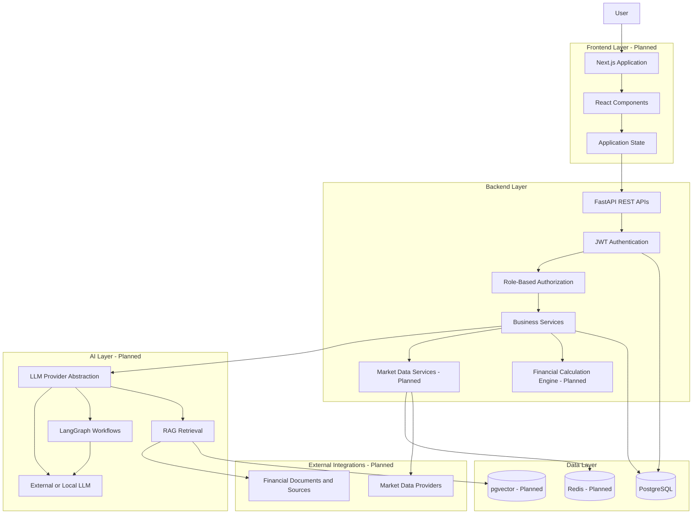
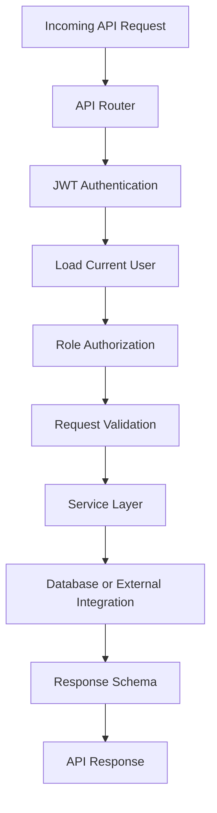
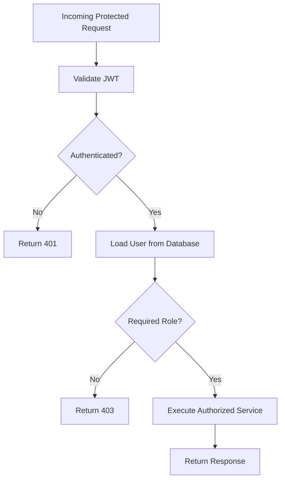
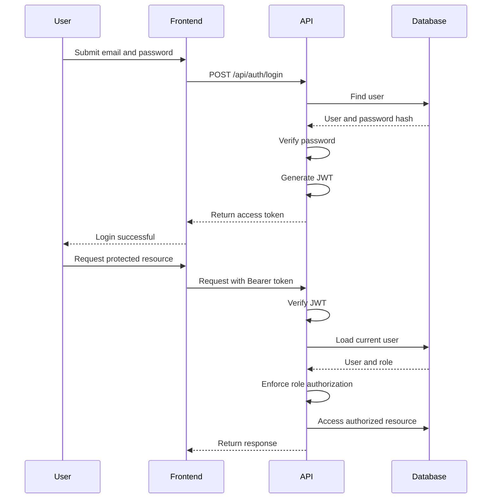
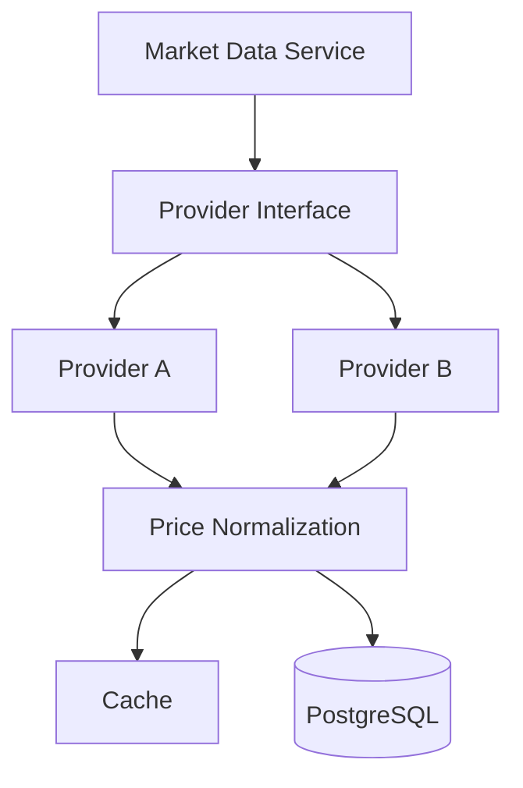
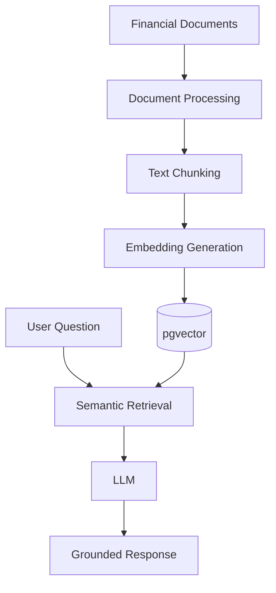

# TradePulse – System Architecture

**Version:** 1.1  
**Status:** Updated Architecture  
**Last Updated:** 2026-11-13

---

## 1. Architecture Overview

TradePulse follows a modular full-stack architecture.

The system consists of:

1. Next.js frontend.
2. FastAPI backend.
3. PostgreSQL database.
4. Authentication and Role-Based Access Control (RBAC).
5. Financial calculation and paper-trading layer.
6. Market data integration layer.
7. AI integration layer.
8. Background processing infrastructure.

The architecture separates presentation, business logic, persistence, financial calculations, authorization, and AI orchestration.

The backend is the authoritative layer for business rules, access control, and financial data.

### 1.1 User Roles

TradePulse uses two strictly separated roles:

| Role | Responsibility |
|---|---|
| ADMIN | Platform administration and asset catalog management |
| USER | Personal portfolio management and investment activities |

**ADMIN permissions:**
- View supported assets.
- Create assets.
- Update asset information.
- Deactivate assets.
- Future platform administration capabilities.

**USER permissions:**
- View supported assets.
- Create and manage personal portfolios.
- Future paper trading and investment analytics.

ADMIN accounts cannot manage portfolios or perform paper trading. USER accounts cannot create, update, or deactivate assets.

All public registrations receive the USER role. ADMIN accounts are provisioned manually.

---

## 2. High-Level Architecture

The diagram represents the target architecture. Components explicitly marked planned are not part of the current implementation.

---

## 3. Frontend Architecture

**Technology:** Next.js, React, TypeScript.

**Status:** Planned.

Responsibilities:

- Display the application interface.
- Manage user interactions.
- Handle authentication state.
- Communicate with backend APIs.
- Display portfolios and analytics.
- Provide AI assistant interfaces.
- Handle loading and error states.
- Display role-appropriate navigation and features.

The frontend may hide or show features according to the authenticated user's role. However, frontend restrictions are not security controls.

The backend must independently enforce all authorization rules.

The frontend must not be responsible for authoritative financial calculations or direct database operations.

---

## 4. Backend Architecture

**Technology:** Python and FastAPI.

**Status:** Core backend foundation implemented.

The backend is the primary application and business-logic layer.

Responsibilities:

- Authenticate users.
- Authorize access using RBAC.
- Validate API requests.
- Manage portfolios.
- Manage supported assets.
- Process future simulated transactions.
- Calculate future financial metrics.
- Retrieve future market data.
- Coordinate future AI operations.
- Persist application data.

### 4.1 Backend Modules

| Module | Responsibility | Status |
|---|---|---|
| Authentication | Registration, login, JWT validation | Implemented |
| Authorization | ADMIN and USER role enforcement | Implemented in code; final API verification pending |
| User | User model and role management foundation | Implemented |
| Portfolio | Portfolio CRUD and ownership validation | Implemented |
| Asset | Asset CRUD and asset catalog management | Implemented |
| Paper Trading | Simulated buy and sell operations | Planned |
| Financial Engine | Portfolio valuation and P&L calculations | Planned |
| Market Data | External price retrieval | Planned |
| AI Integration | LLM orchestration and assistant operations | Planned |

### 4.2 Backend Request Flow

The backend request flow includes authentication and role authorization before executing protected business operations.

### 4.3 Role-Based Authorization Flow

The user's role is obtained from the database through the authenticated user record.

Role definitions are centralized in:

`app/constants/roles.py`

The authorization dependencies are implemented in:

- `require_role()`
- `require_admin`
- `require_user`

### 4.4 Authorization Matrix

| Operation | ADMIN | USER |
|---|---|---|
| Register account | Public registration creates USER | Public registration creates USER |
| Login | Allowed | Allowed |
| View current profile | Allowed | Allowed |
| View assets | Allowed | Allowed |
| Create assets | Allowed | Forbidden |
| Update assets | Allowed | Forbidden |
| Deactivate assets | Allowed | Forbidden |
| Create portfolio | Forbidden | Allowed |
| View own portfolios | Forbidden | Allowed |
| Update own portfolios | Forbidden | Allowed |
| Delete own portfolios | Forbidden | Allowed |
| Paper trading | Forbidden | Planned |
| Personal portfolio analytics | Forbidden | Planned |

The backend must enforce these restrictions regardless of frontend behavior.

---

## 5. Database Architecture

**Technology:** PostgreSQL and SQLAlchemy ORM.

**Status:** Database foundation and current User, Portfolio, and Asset models implemented.

PostgreSQL stores the application's persistent data.

### 5.1 Initial Entities

**Users**

Stores account information and authentication-related data.

Important fields:

- id
- full_name
- email
- password_hash
- role
- created_at

The role field supports ADMIN and USER, with USER as the default for public registration.

**Portfolios**

Stores portfolios owned by USER accounts.

Important fields:

- id
- user_id
- name
- description
- base_currency
- initial_cash_balance
- cash_balance
- created_at
- updated_at

**Assets**

Stores supported asset information.

Important fields:

- id
- symbol
- name
- asset_type
- exchange
- currency
- is_active
- created_at
- updated_at

Current supported asset types:

- STOCK
- CRYPTO

Asset records are shared platform resources.

**Transactions - Planned**

Stores simulated buy and sell activities.

**Holdings - Planned**

Represents asset positions within portfolios. The implementation must define whether holdings are maintained as transactional state or derived from transaction history.

**Market Prices - Planned**

Stores historical or current price observations, including timestamps and provider information.

Database relationships and constraints are documented in `DATABASE_DESIGN.md`.

---

## 6. Authentication and Authorization Architecture

Authentication uses JWT access tokens.

Passwords are hashed using Argon2.

### 6.1 Authentication Flow

### 6.2 Role Assignment

- Public registration always assigns USER.
- Registration does not accept a role field.
- ADMIN accounts are provisioned manually in PostgreSQL.
- Role definitions are centralized in the application.
- Role authorization is enforced on the backend.

The current authorization implementation loads the user record from the database. Therefore, authorization uses the current database role rather than relying solely on a role value embedded in a previously issued token.

### 6.3 HTTP Authorization Behavior

| Condition | HTTP Status |
|---|---|
| Missing or invalid token | 401 |
| Authenticated user lacks required role | 403 |
| Requested resource does not exist or is outside ownership scope | 404 |

---

## 7. Paper Trading Architecture

**Status:** Planned.

Paper trading is a core business capability.

The trading engine will process simulated transactions without interacting with real brokerage execution systems.

### 7.1 Simulated Buy Flow

1. Receive buy request.
2. Validate authenticated USER.
3. Validate portfolio ownership.
4. Validate asset.
5. Obtain an eligible price observation.
6. Validate available simulated cash.
7. Calculate transaction amount and applicable fees.
8. Record transaction.
9. Update holdings and cash balance.
10. Return transaction details.

### 7.2 Simulated Sell Flow

1. Receive sell request.
2. Validate authenticated USER.
3. Validate portfolio ownership.
4. Validate available asset quantity.
5. Obtain an eligible price observation.
6. Calculate transaction value and fees.
7. Record transaction.
8. Update holdings and cash balance.
9. Return transaction details.

Transaction processing must use appropriate database transactions and consistency controls to prevent duplicate or conflicting operations.

Paper trading must remain separate from real-money brokerage execution.

---

## 8. Market Data Architecture

**Status:** Planned.

Market data is accessed through an abstraction layer.

The application should not depend directly on a specific provider's response format.

Market data must include source and timestamp information.

The provider abstraction should support replacing or adding market data providers without changing core portfolio services.

---

## 9. AI Architecture

**Status:** Planned.

AI capabilities are isolated from core financial calculations.

### 9.1 AI Provider Abstraction

A provider interface will allow the application to use different LLM providers.

Possible implementations:

- OpenAI.
- Google Gemini.
- Anthropic.
- Ollama or other local models.

The application should be able to switch providers without rewriting its core business services.

### 9.2 AI Investment Assistant

The assistant will receive user questions and access approved application data through controlled backend services.

Potential capabilities:

- Explain portfolio performance.
- Summarize portfolio allocation.
- Explain financial terminology.
- Analyze retrieved market information.
- Summarize financial documents.

The AI assistant must not independently modify financial records or execute real-money trades.

### 9.3 RAG Architecture

### 9.4 AI Agent Architecture

LangGraph may be used for multi-step workflows.

Possible workflow:

1. Receive research request.
2. Identify the required information.
3. Call approved research tools.
4. Retrieve relevant documents.
5. Analyze retrieved information.
6. Generate a structured response.
7. Include available source references.

All agent tools must enforce authentication, authorization, and execution permissions.

AI operations must access only the current USER's authorized portfolio data.

---

## 10. Background Processing Architecture

**Status:** Planned.

Redis and Celery may be introduced for asynchronous tasks.

Potential use cases:

- Market data synchronization.
- Historical price ingestion.
- Document processing.
- Embedding generation.
- Scheduled portfolio analytics.
- Long-running AI research workflows.

These components are planned infrastructure, not part of the current initial implementation.

---

## 11. Security Architecture

Security responsibilities include:

- Argon2 password hashing.
- JWT signature and expiration verification.
- Role-based authorization.
- Resource-level authorization.
- Portfolio ownership validation.
- User-specific database access.
- Environment-based secrets.
- Input validation.
- Controlled AI tool execution.
- Protection against duplicate financial transactions.
- Prevention of unauthorized role assignment.

Financial data must never be exposed across user accounts.

The frontend must not be treated as the source of truth for authorization.

ADMIN and USER permissions must be enforced by backend dependencies and service-level resource checks.

---

## 12. Deployment Architecture

### 12.1 Initial Development

Current development environment:

- FastAPI with Uvicorn.
- Local PostgreSQL.
- SQLAlchemy ORM.
- Alembic migrations.
- Local Python virtual environment.
- Local environment configuration.

Frontend development with Next.js is planned.

### 12.2 Future Deployment

Future deployment may use:

- Containerized frontend and backend.
- Managed PostgreSQL.
- Redis.
- Cloud-hosted model providers or local inference.
- Centralized logs and monitoring.

Deployment infrastructure will be finalized based on performance, cost, and operational requirements.

---

## 13. Architecture Principles

1. Separation of concerns.
2. Modular service design.
3. Provider-independent integrations.
4. Secure-by-default development.
5. Deterministic financial calculations.
6. Explicit role-based authorization.
7. Strict separation between ADMIN and USER responsibilities.
8. Portfolio ownership enforcement.
9. Auditable transaction history.
10. Testable business logic.
11. Incremental infrastructure adoption.
12. AI as an assistant, not the authority for financial records.

---

## 14. Current Implementation Status

### 14.1 Implemented Foundation

- FastAPI application.
- PostgreSQL connection.
- SQLAlchemy ORM.
- Alembic migrations.
- User model and database table.
- User registration.
- Argon2 password hashing.
- JWT generation and verification implementation.
- Protected current-user endpoint.
- User role field and role constraint.
- Centralized role definitions.
- Role authorization dependencies.
- Portfolio model and CRUD APIs.
- Portfolio ownership validation.
- Asset model and database migration.
- Asset schemas and service layer.
- Asset CRUD route implementation.

### 14.2 Final Verification Pending

- USER-only authorization for all portfolio endpoints.
- ADMIN-only authorization for asset creation, updating, and deactivation.
- ADMIN and USER access to asset read endpoints.
- Complete role-based API testing through Swagger or automated tests.

### 14.3 Planned

- Next.js frontend.
- Paper-trading engine.
- Financial calculation engine.
- Holdings management.
- Market-data integrations.
- Portfolio analytics.
- AI provider abstraction.
- RAG.
- AI agents.
- Redis and Celery background processing.
- Production deployment.

Implementation status must be updated as features are completed and verified.

---

**Document Owner:** TradePulse Development  
**Last Updated:** 2026-11-13