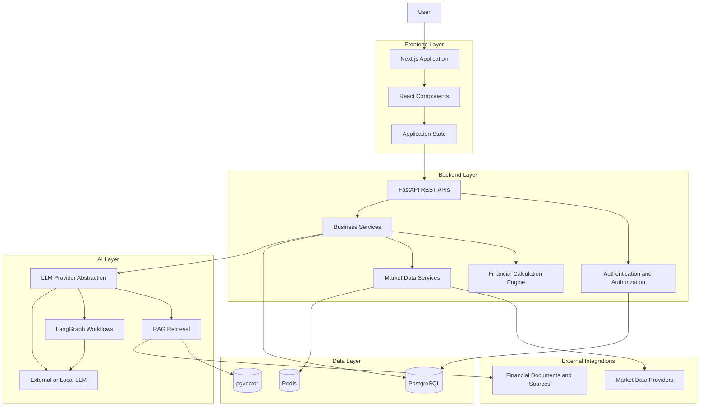
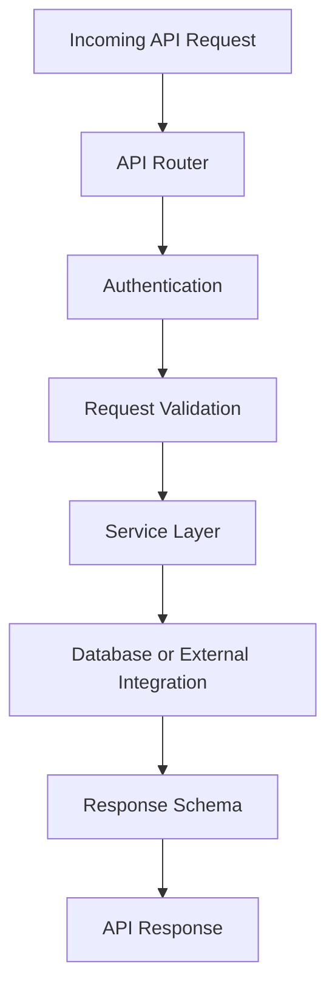
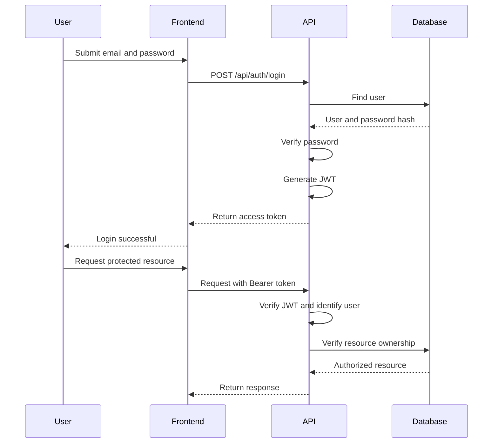
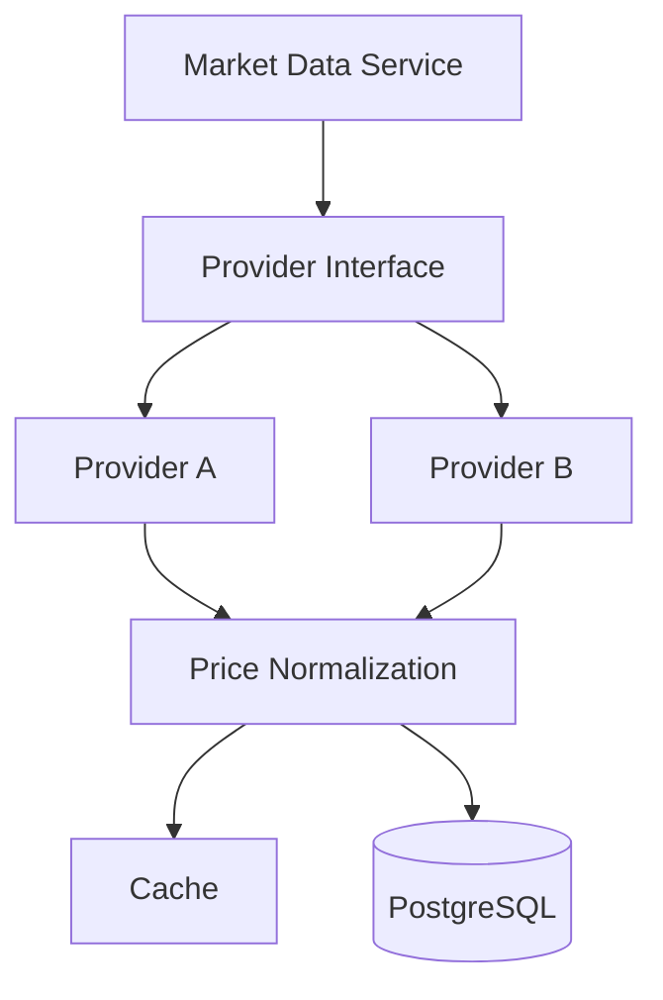
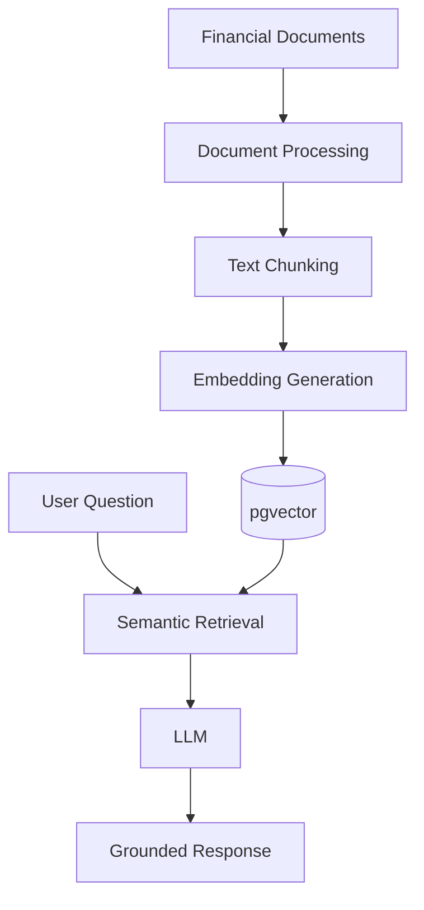

# TradePulse – System Architecture

**Version:** 1.0  
**Status:** Initial Architecture Draft

---

## 1. Architecture Overview

TradePulse follows a modular full-stack architecture.

The system consists of:

1. Next.js frontend.
2. FastAPI backend.
3. PostgreSQL database.
4. Market data integration layer.
5. AI integration layer.
6. Background processing infrastructure.

The architecture separates presentation, business logic, persistence, financial calculations, and AI orchestration.

## 2. High-Level Architecture

## 3. Frontend Architecture

**Technology:** Next.js, React, TypeScript.

Responsibilities:

- Display the application interface.
- Manage user interactions.
- Handle authentication state.
- Communicate with backend APIs.
- Display portfolios and analytics.
- Provide AI assistant interfaces.
- Handle loading and error states.

The frontend must not be responsible for authoritative financial calculations or database operations.

## 4. Backend Architecture

**Technology:** Python and FastAPI.

The backend is the primary application and business-logic layer.

Responsibilities:

- Authenticate users.
- Authorize access to resources.
- Validate API requests.
- Manage portfolios.
- Process simulated transactions.
- Calculate financial metrics.
- Retrieve market data.
- Coordinate AI operations.
- Persist application data.

### Backend Request Flow

## 5. Database Architecture

**Technology:** PostgreSQL and SQLAlchemy ORM.

PostgreSQL stores the application's persistent data.

Initial entities:

### Users
Stores account information and authentication-related data.

### Portfolios
Stores portfolios owned by users.

### Assets
Stores supported asset information.

### Transactions
Stores simulated buy and sell activities.

### Holdings
Represents asset positions within portfolios. The implementation must define whether holdings are maintained as transactional state or derived from transaction history.

### Market Prices
Stores historical or current price observations, including timestamps and provider information.

Database relationships and constraints will be documented in DATABASE_DESIGN.md.

## 6. Authentication Architecture

Authentication uses JWT access tokens.

## 7. Paper Trading Architecture

Paper trading is a core business capability.

The trading engine will process simulated transactions without interacting with real brokerage execution systems.

### Simulated Buy Flow

1. Receive buy request.
2. Validate authenticated user.
3. Validate portfolio ownership.
4. Validate asset.
5. Obtain an eligible price observation.
6. Validate available simulated cash.
7. Calculate transaction amount and applicable fees.
8. Record transaction.
9. Update or recalculate holdings and cash balance.
10. Return transaction details.

### Simulated Sell Flow

1. Receive sell request.
2. Validate authenticated user.
3. Validate portfolio ownership.
4. Validate available asset quantity.
5. Obtain an eligible price observation.
6. Calculate transaction value and fees.
7. Record transaction.
8. Update or recalculate holdings and cash balance.
9. Return transaction details.

Transaction processing must use appropriate database transactions and consistency controls to prevent duplicate or conflicting operations.

## 8. Market Data Architecture

Market data is accessed through an abstraction layer.

The application should not depend directly on a specific provider's response format.

Market data must include source and timestamp information.

## 9. AI Architecture

AI capabilities are isolated from core financial calculations.

### AI Provider Abstraction

A provider interface will allow the application to use different LLM providers.

Possible implementations:

- OpenAI.
- Google Gemini.
- Anthropic.
- Ollama or other local models.

The application should be able to switch providers without rewriting its core business services.

### AI Investment Assistant

The assistant will receive user questions and access approved application data through controlled backend services.

Potential capabilities:

- Explain portfolio performance.
- Summarize portfolio allocation.
- Explain financial terminology.
- Analyze retrieved market information.
- Summarize financial documents.

### RAG Architecture

### AI Agent Architecture

LangGraph may be used for multi-step workflows.

Possible workflow:

1. Receive research request.
2. Identify the required information.
3. Call approved research tools.
4. Retrieve relevant documents.
5. Analyze retrieved information.
6. Generate a structured response.
7. Include available source references.

All agent tools must enforce authentication, authorization, and execution permissions.

## 10. Background Processing Architecture

Redis and Celery may be introduced for asynchronous tasks.

Potential use cases:

- Market data synchronization.
- Historical price ingestion.
- Document processing.
- Embedding generation.
- Scheduled portfolio analytics.
- Long-running AI research workflows.

These components are planned infrastructure, not part of the current initial implementation.

## 11. Security Architecture

Security responsibilities include:

- Argon2 password hashing.
- JWT signature and expiration verification.
- Resource-level authorization.
- User-specific database access.
- Environment-based secrets.
- Input validation.
- Controlled AI tool execution.
- Protection against duplicate financial transactions.

Financial data must never be exposed across user accounts.

## 12. Deployment Architecture

Initial development:

- Next.js development server.
- FastAPI with Uvicorn.
- Local PostgreSQL.
- Local environment configuration.

Future deployment may use:

- Containerized frontend and backend.
- Managed PostgreSQL.
- Redis.
- Cloud-hosted model providers or local inference.
- Centralized logs and monitoring.

Deployment infrastructure will be finalized based on performance, cost, and operational requirements.

## 13. Architecture Principles

1. Separation of concerns.
2. Modular service design.
3. Provider-independent integrations.
4. Secure-by-default development.
5. Deterministic financial calculations.
6. Explicit authorization.
7. Auditable transaction history.
8. Testable business logic.
9. Incremental infrastructure adoption.
10. AI as an assistant, not the authority for financial records.

## 14. Current Implementation Status

### Implemented foundation
- FastAPI application.
- PostgreSQL connection.
- SQLAlchemy ORM.
- Alembic migrations.
- User model and database table.
- User registration.
- Argon2 password hashing.
- JWT generation and verification implementation.
- Protected profile endpoint implementation.

### Planned
- Portfolio management.
- Asset management.
- Paper-trading engine.
- Market-data integrations.
- Portfolio analytics.
- AI provider abstraction.
- RAG.
- AI agents.
- Background processing.
- Production deployment.

---

**Document Owner:** TradePulse Development  
**Last Updated:** 2026-11-13